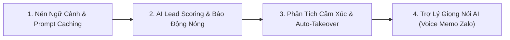

# KẾ HOẠCH CHI PHÍ VẬN HÀNH & BÁO CÁO NÂNG CẤP TỐI ƯU HỆ THỐNG ADDP CRM (`crm.addp.vn`)

> **Thời điểm lập báo cáo:** Ngày 14/11/2026  
> **Dự án:** Hệ Thống Quản Trị Khách Hàng & Vận Hành Bán Hàng Đa Kênh ADDP CRM  
> **Tên miền vận hành:** `https://crm.addp.vn` (Đặt trên Server nội bộ Công ty Cổ phần Dược phẩm ADDP)

---

## PHẦN 1: BẢNG THỐNG KÊ CHI PHÍ TOÀN BỘ HỆ THỐNG PHẦN MỀM

Toàn bộ kiến trúc ADDP CRM được thiết kế theo định hướng **Tự chủ công nghệ (Self-Hosted In-House)**, kế thừa tối đa hạ tầng sẵn có của công ty, giúp cắt giảm hơn **90% chi phí bản quyền phần mềm SaaS** bên ngoài.

### 1. Chi phí Hạ tầng & Máy chủ (Server & Infrastructure)

| Hạng mục | Nhà cung cấp / Nền tảng | Cấu hình / Hiện trạng | Chi phí hàng tháng | Ghi chú |
| :--- | :--- | :--- | :---: | :--- |
| **Máy chủ Web & App** | Server nội bộ ADDP (DirectAdmin / Linux) | Chạy song song Next.js Portal (cổng 3005), FastAPI Javis OS (cổng 8000), PM2 Process Manager | **0 VNĐ** | Tận dụng 100% server có sẵn của công ty |
| **Cơ sở dữ liệu chính** | MySQL 8.0 / MariaDB 10.6 | Lưu trữ tập trung `addp_crm`: Khách hàng, Đơn hàng, Lịch chăm sóc, Hội thoại | **0 VNĐ** | Chạy nội bộ trên server |
| **Hàng đợi & Cache** | Redis 7.0 In-Memory | Quản lý Smart Broadcast Queue, Rate-limit Zalo chống khóa nick | **0 VNĐ** | Chạy nội bộ trên server |
| **Tên miền & SSL** | Domain `crm.addp.vn` | Chứng chỉ SSL Let's Encrypt tự động gia hạn | **0 VNĐ** | Đã bao gồm trong gói Domain công ty |
| **Lưu trữ File & Vector RAG** | Ổ cứng Server nội bộ | Lưu trữ File tài liệu tri thức (`.data/knowledge_docs/`) và Vector Cosine Similarity | **0 VNĐ** | Không cần thuê dịch vụ đắt đỏ ngoài (như Pinecone hay AWS S3) |
| **TỔNG CHI PHÍ HẠ TẦNG** | | | **0 VNĐ / tháng** | **Tiết kiệm hoàn toàn** |

---

### 2. Chi phí API Kết Nối 7 Nền Tảng (Omnichannel Connectors)

| Nền tảng kết nối | Giao thức kết nối | Giới hạn / Hạn mức | Chi phí phần mềm | Ghi chú vận hành |
| :--- | :--- | :--- | :---: | :--- |
| **Zalo Cá Nhân** | `zca-js` / QR Session trên Server | Không giới hạn số lượng nick đăng nhập | **0 VNĐ** | Tự động giữ phiên, không phụ thuộc bên thứ 3 |
| **Zalo OA (Official Account)** | Zalo OA Open API v3 & Webhook | Nhận và gửi tin nhắn trong khung 48h | **0 VNĐ** | Dùng API chính thức miễn phí của Zalo Business |
| **Fanpage Facebook** | Meta Graph API v19.0 & Webhook | Tiếp nhận tin nhắn Messenger & Comment Livestream | **0 VNĐ** | Tự tạo App Facebook Doanh nghiệp nội bộ |
| **TikTok Shop** | TikTok Shop Partner Open API | Đồng bộ đơn hàng, SKU, tin nhắn Shop | **0 VNĐ** | App nội bộ In-House System |
| **Shopee** | Shopee Open Platform Console v2 | Đồng bộ đơn hàng, SKU đa gian hàng | **0 VNĐ** | App Seller In-House System |
| **KiotViet POS** | KiotViet Open API | Đồng bộ sản phẩm, tồn kho, đẩy đơn nhanh | **0 VNĐ** | Đã bao gồm trong gói dịch vụ KiotViet của công ty |
| **Website Magento 2.4.8** | Magento REST API & Webhook | Đổ lead từ form `Addp_CustomForm` và Minigame | **0 VNĐ** | Kết nối trực tiếp cơ sở dữ liệu và API Magento |
| **TỔNG CHI PHÍ KẾT NỐI 7 KÊNH** | | | **0 VNĐ / tháng** | **Không mất phí duy trì nền tảng** |

---

### 3. Chi phí Trí Tuệ Nhân Tạo (AI Router & LLM API)

Hệ thống sử dụng cơ chế định tuyến thông minh kết hợp giữa **Mô hình GPT-4o-mini (OpenAI)** và **Gemini 2.5 Flash (Google)**. 

#### A. Số liệu tiêu hao thực tế kiểm chứng sáng ngày 14/11/2026:
- **Số lượt tin nhắn Bot đã trả lời:** 19 requests
- **Tổng tokens tiêu thụ:** 95,757 tokens (trung bình ~5,000 tokens / 1 lượt chat chuyên sâu)
- **Tổng chi phí trừ thực tế trên OpenAI:** **0.01 \$** (~250 VNĐ)
- **Đơn giá thực tế trên 1 tin nhắn tư vấn AI:** **~0.00052 \$ (~13 VNĐ / 1 tin nhắn)**

#### B. Bảng dự toán chi phí AI theo các mức độ quy mô vận hành:

| Quy mô vận hành | Lượng tin AI trả lời / ngày | Số tin nhắn / tháng | Chi phí AI / ngày (USD) | **Tổng chi phí AI / tháng (VNĐ)** |
| :--- | :---: | :---: | :---: | :---: |
| **Mức 1: Thử nghiệm** | 50 tin / ngày | 1.500 tin | ~0.026 \$ | **~20.000 VNĐ / tháng** |
| **Mức 2: Vận hành bình thường** | 200 tin / ngày | 6.000 tin | ~0.104 \$ | **~79.000 VNĐ / tháng** |
| **Mức 3: Đội ngũ nhiều nick Zalo** | 500 tin / ngày | 15.000 tin | ~0.260 \$ | **~198.000 VNĐ / tháng** |
| **Mức 4: Chạy Ads & Livestream lớn** | 1.000 tin / ngày | 30.000 tin | ~0.520 \$ | **~396.000 VNĐ / tháng** |

> **SO SÁNH HIỆU QUẢ KINH TẾ (ROI):**  
> - Một nhân viên trực chat 1 ca (8 tiếng/ngày) xử lý tối đa 80 – 120 tin, chi phí lương từ **7.000.000 – 10.000.000 VNĐ/tháng**.  
> - Bot AI trực **24/7/365**, phản hồi sau 3 giây, xử lý cùng lúc hàng trăm khách hàng, chi phí chỉ từ **80.000 – 400.000 VNĐ/tháng** (tiết kiệm hơn **95% chi phí** nhân sự trực ngoài giờ/ca đêm).

---

## PHẦN 2: BÁO CÁO TOÀN BỘ CÁC HẠNG MỤC ĐÃ NÂNG CẤP & TỐI ƯU

Trong các đợt hoàn thiện vừa qua, hệ thống đã được nâng cấp toàn diện trên các module trọng yếu:

### 1. Cơ chế Phân quyền & Điều khiển Bot 2 Tầng (Opt-in per Customer)
- **Chuyển chế độ mặc định sang "Nhân viên trực (HUMAN)":** Toàn bộ các nick Zalo và tất cả khách hàng mới vào hệ thống đều mặc định 100% là Sale trực. Tuyệt đối không tự ý bật AI tràn lan.
- **Chỉ định độc lập theo từng khách hàng:** Chỉ khi nhân viên hoặc quản lý chủ động gạt công tắc `Khách này: [BẬT] 🤖 AI Trực`, duy nhất khách hàng đó mới được Bot AI chăm sóc và hiện huy hiệu tím `AI`. Mọi khách hàng khác trong danh bạ vẫn giữ nguyên chế độ Sale trực.

### 2. Bộ Tự Học Phong Cách Theo Từng Tài Khoản (`accountLearner.js`)
- **Tự động quét lịch sử hội thoại thực tế (`history.jsonl`):** Bot tự phân tích hàng trăm hội thoại cũ của từng nick (như nick `Ngọc Linh - Addp`).
- **Học phong cách giao tiếp thực tế:** Tự nhận diện cách xưng hô chủ đạo (`con/cháu - cô/chú` hoặc `em - anh/chị`), độ dài câu trung bình, cách dùng trợ từ lịch sự (`ạ`, `nhé`, `nha`).
- **Trích xuất 80 cặp Q&A thực tế:** Tự động tạo kho ví dụ mẫu (Few-shot Examples) theo từng chủ đề bệnh lý (tiểu đường, sữa hạt Glucare Plus, tăng cân, tăng cơ, liều dùng, giá bán) để nạp vào AI, giúp câu trả lời tự nhiên chuẩn văn phong của chính nhân viên nick đó.

### 3. Đấu nối Trí Tuệ Nhân Tạo Thật (OpenAI GPT-4o-mini & Vector RAG)
- **Kết nối LLM đa tầng:** Xóa bỏ cơ chế trả lời bằng câu lệnh cứng lặp đi lặp lại. Bot tự động nạp kịch bản Chuyên viên tư vấn dinh dưỡng 10 năm kinh nghiệm (chuẩn Bác sĩ 3 bước: Thăm hỏi khai thác $\rightarrow$ Lộ trình ăn uống đảo ngược + Giải pháp $\rightarrow$ Kêu gọi hành động khéo léo).
- **Mở rộng cửa sổ ngữ cảnh (Context 40 tin nhắn):** Cho phép AI đọc toàn bộ lịch sử trò chuyện liền mạch, hiểu rõ khách vừa nói gì để không hỏi lại câu khách vừa trả lời.
- **Hợp nhất Hồ sơ 360:** Nạp đầy đủ thông tin khách hàng, thẻ phân loại, bệnh lý, lịch sử các đơn hàng đã mua để tư vấn đúng trọng tâm.

### 4. Khắc phục Tính Năng Xóa Bot Chat (`deleted_bot_profiles.json`)
- **Khắc phục lỗi tự động tái sinh Bot:** Trước đây khi xóa Bot, cơ chế tự động quét sẽ sinh lại bot mẫu. Hiện đã bổ sung danh sách loại trừ bền vững (`deleted_bot_profiles.json`), đảm bảo khi bấm "Xóa" là Bot biến mất vĩnh viễn khỏi danh sách.
- **Dọn dẹp triệt để:** Tự động xóa file cache trí nhớ tự học của Bot bị xóa.
- **Bổ sung nút "🔄 Khôi phục Bot mặc định":** Giúp quản trị viên có thể phục hồi lại các Bot mẫu hệ thống khi cần chỉ với 1 cú click.

### 5. Tối ưu Tiến trình Chạy Ngầm (Watcher 24/7 & Anti-Ban Zalo)
- **Vòng lặp quét tự động ngầm 24/7:** Bot tự động theo dõi tin nhắn mới kể cả khi nhân viên không mở tab trình duyệt.
- **Cơ chế kích hoạt kép:** Tự động quét và trả lời ngay khi nhân viên click mở hội thoại.
- **Thời gian chờ gõ phím (Typing Delay 3s):** Chống vi phạm chính sách gửi tin của Zalo, tạo cảm giác như người thật đang soạn tin.

---

## PHẦN 3: ĐỀ XUẤT LỘ TRÌNH NÂNG CẤP & TỐI ƯU TIẾP THEO

Để hệ thống vận hành ngày càng thông minh, mượt mà và tiết kiệm chi phí tối đa, đội ngũ đề xuất 4 hạng mục nâng cấp trọng điểm tiếp theo:

1. **Tối ưu hóa Prompt Caching & Nén ngữ cảnh động:**
   - Khi hội thoại của khách vượt quá 20 tin nhắn, hệ thống tự động tóm tắt các tin cũ thành một đoạn ngắn gọn (`ai-summary`) thay vì gửi toàn bộ văn bản dài.
   - Giúp giảm thêm **30% – 50% chi phí API tokens** mà AI vẫn nắm chắc 100% bệnh lý của khách.

2. **Chấm điểm Khách hàng Tiềm năng (AI Lead Scoring):**
   - AI tự động đánh giá mức độ quan tâm của khách theo thang điểm 1 – 10 (dựa trên việc khách hỏi giá, hỏi địa chỉ, gửi số điện thoại).
   - Tự động gắn nhãn `🔥 Khách Nóng - Chốt Ngay` và phát âm thanh thông báo đẩy cho Sale Leader can thiệp hỗ trợ chốt đơn.

3. **Phân tích Cảm xúc Khách hàng & Tự Động Chuyển Giao (Sentiment Analysis & Auto-Takeover):**
   - Nếu khách hàng có biểu hiện bức xúc, phàn nàn về giao hàng chậm hoặc sản phẩm, AI nhận diện ngay cảm xúc tiêu cực, lập tức ngừng bot tự động và chuyển quyền tiếp quản cho Quản lý CSKH kèm lời xin lỗi nhẹ nhàng.

4. **Trợ lý Tin Nhắn Thoại AI (Voice Memo Zalo):**
   - Tích hợp công nghệ Text-to-Speech (TTS) tiếng Việt ấm áp, cho phép Bot gửi tin nhắn âm thanh ngắn (Voice Memo) tư vấn chế độ ăn uống cho các cô/chú lớn tuổi lười đọc chữ trên Zalo, tăng tỷ lệ tin tưởng và chốt đơn vượt bậc.

---

*Báo cáo được lưu trữ chính thức tại kho mã nguồn dự án: `c:\addp-crm\KE_HOACH_CHI_PHI_VA_NANG_CAP_HE_THONG.md` và đồng bộ cùng tiến độ `TASKS.md`.*
